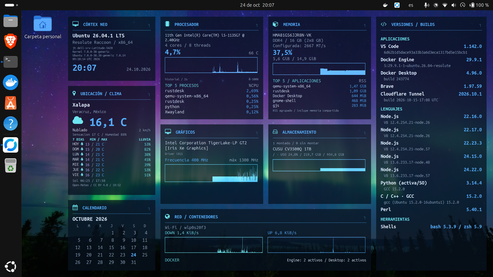

<!-- Generated by scripts/generate_readme.py; edit docs/readme/ instead. -->
<div align="center">

# CORTEX NEO · Tema para Conky

**Tu escritorio Linux, en tiempo real.**

[English](README.md) · [Español](README.es.md)

[](https://github.com/JorgeTato99/cortex-neo-conky-theme/actions/workflows/ci.yml)
[](LICENSE)
[](pyproject.toml)

</div>

CORTEX NEO convierte la información del sistema en tarjetas neón independientes. Python recopila telemetría compartida; Lua y Conky presentan gráficas históricas, datos opcionales del hardware y herramientas locales de diagnóstico. Las herramientas y sensores ausentes se omiten o indican como no disponibles, sin inventar lecturas.

## Escritorios reales

### Ryzen 7 5700X · NVIDIA RTX 4060 Ti

2560 × 1440 · Escalado del escritorio GNOME: **166,67 %**.


### Dell Latitude 5420 · Intel Iris Xe

1920 × 1080 · Escalado del escritorio GNOME: **125 %**.



Ambas imágenes son capturas actuales de instalaciones reales. Los valores y versiones reflejan el momento de la captura; no están incluidos manualmente en el tema. WebP sin pérdida conserva las dimensiones originales y todos los píxeles decodificados. [Fechas, configuración de pantalla y procedencia](docs/es/validation/screenshots.md).

## Qué muestra

- **Sistema:** distribución/versión, kernel/compilación, arquitectura y reloj.
- **CPU:** modelo, núcleos/hilos, temperatura, histórico de uso y procesos destacados.
- **RAM:** uso, memoria disponible, datos opcionales de módulos/tipo/velocidad y RSS agrupada por aplicación.
- **GPU:** modelo detectado, driver y sensores disponibles; uso/VRAM o frecuencia con sus unidades reales.
- **Almacenamiento:** uso de filesystems y unidades montadas/sin montar, distinguiendo discos del mismo modelo.
- **Red y Docker:** histórico de tráfico, conteos separados de Engine/Desktop y grupos Compose.
- **Versiones/builds:** aplicaciones y toolchains instalados; las categorías vacías desaparecen y los inventarios largos se paginan.
- **Clima y calendario:** pronóstico de siete días de una ciudad configurada manualmente y calendario mensual con el día actual destacado.

Las métricas se actualizan cada **2 segundos**. Los cambios de montaje refrescan el inventario de almacenamiento; la exploración completa de discos se hace cada 30 segundos. Las versiones y el clima usan cadencias mayores para mantener ligero el muestreo frecuente.

## Instalación rápida

Requiere **Linux con sesión gráfica, systemd de usuario y Python 3.11+**. Los perfiles automáticos de paquetes cubren Ubuntu 24.04/26.04 y Debian 12/13.

Descarga y extrae el código [ZIP](https://github.com/JorgeTato99/cortex-neo-conky-theme/archive/refs/heads/main.zip), y ejecuta desde esa carpeta:

```bash
bash scripts/install.sh
```

Ejecuta como tu usuario del escritorio; solo apt necesita sudo. El instalador prepara Conky, GTK, fuentes y su entorno Python, habilita los servicios del usuario y conserva las preferencias personales. No instala Docker, lenguajes de programación ni drivers de GPU. [Opciones y comprobaciones de instalación](docs/es/getting-started/installation.md).

## Personalización

```bash
cortex-neo configure --language es --palette blue --font ubuntu
cortex-neo configure --detail-level essential
cortex-neo configure --profile compact --density comfortable
cortex-neo configure --profile full --density complete --detail-level full
```

Si el comando todavía no está en PATH, usa `~/.local/bin/cortex-neo`.

- **Diez paletas completas:** `blue`, `teal`, `green`, `yellow`, `orange`, `red`, `pink`, `purple`, `slate`, `brown`.
- **Tres perfiles de fuente:** `ubuntu` (Ubuntu Sans Mono), `dejavu` (DejaVu Sans Mono), `liberation` (Liberation Mono). Las familias ausentes se sustituyen de forma segura; los iconos conservan FontAwesome.
- **Nivel de detalle independiente:** `essential` oculta especificaciones y builds secundarios; `full` los restaura. Conserva modelos, versiones, métricas, gráficas y procesos principales.
- **Distribución adaptable:** perfiles full/compact, densidad comfortable/complete, orientación horizontal/vertical, opacidad y selección de tarjetas.

El resumen muestra dos escritorios reales; las demás variantes de color están en una galería separada. [Ver las diez paletas en un escritorio real](docs/es/reference/appearance.md).

Edita archivos JSON sencillos en `~/.config/cortex-neo/` o usa la CLI. Las actualizaciones conservan tus preferencias y la ciudad configurada a mano. [Guía de configuración](docs/es/getting-started/configuration.md).

## Herramientas locales de desarrollo y diagnóstico

| Necesidad | Comando / guía |
|---|---|
| Comprobar dependencias/sesión e identificar las fuentes instaladas | `doctor` / `version` · [Guía](docs/es/guides/troubleshooting.md) |
| Medir CPU/RSS y tamaño de los datos del dashboard | `performance` · [Guía](docs/es/guides/performance.md) |
| Entender RAM disponible, swap, PSI y PSS/USS explícitos | `memory` · [Guía](docs/es/guides/memory.md) |
| Inspeccionar motores, servicios y proyectos Compose | `containers` · [Guía](docs/es/guides/docker-projects.md) |
| Conservar una ventana de incidente antes/después | `incident` · [Guía](docs/es/guides/incidents.md) |
| Consultar históricos numéricos por minuto | `history` · [Guía](docs/es/guides/history.md) |
| Medir un comando explícito de pruebas/compilación | `run` / `tasks` · [Guía](docs/es/guides/tasks.md) |
| Revisar contexto seleccionado para un agente | `context` · [Guía](docs/es/guides/agent-context.md) |
| Comparar observaciones de entorno guardadas | `baseline-save` / `compare` · [Guía](docs/es/guides/baselines.md) |
| Ocultar etiquetas personales y revisar un informe de soporte | `presentation` / `report` · [Guía](docs/es/guides/sharing.md) |

Estas herramientas son locales y optativas. Las observaciones conservan sus límites de frescura y contabilidad; no deducen causas ni administran automáticamente procesos, contenedores o equipos remotos.

## Equipos comprobados y compatibilidad

| Equipo | CPU / RAM | GPU | Sistema comprobado |
|---|---|---|---|
| Ryzen 7 5700X | 8 núcleos / 16 hilos · 64 GB DDR4 | RTX 4060 Ti 8 GB | Ubuntu 26.04.1 LTS · GNOME Wayland |
| Dell Latitude 5420 | Core i5-1135G7 · 16 GB DDR4 | Intel Iris Xe | Ubuntu 26.04.1 LTS · GNOME Wayland |

La validación combina Python 3.11–3.15, callbacks Lua reales, lógica ARM64 nativa, instalación/render en cuatro distribuciones limpias y dos equipos físicos Ubuntu GNOME. Los sensores dependen del kernel, driver y permisos; la cobertura AMD usa fixtures de momento. [Alcance de compatibilidad](docs/es/reference/compatibility.md) · [Pruebas y límites](docs/es/validation/testing.md).

## Privacidad y ubicación manual

El clima requiere una **ciudad configurada manualmente**. No hay detección por GeoIP, GPS, GeoClue ni Wi-Fi. Open-Meteo recibe las coordenadas configuradas y la información de red normal de la petición; no se promete anonimato de red.

Las preferencias, cachés, capturas y registros privados viven fuera del código, en rutas XDG. Los informes seleccionan campos para revisión y nunca se envían automáticamente. [Datos, ubicación y capturas](docs/es/reference/privacy.md).

## Actualizar y desinstalar

Ejecuta el mismo instalador desde un ZIP nuevo o tu clon actualizado y comprueba el resultado:

```bash
bash scripts/install.sh
cortex-neo version
cortex-neo doctor
```

Las versiones inmutables se preparan antes del cambio; un fallo de activación restaura el entorno anterior. `cortex-neo uninstall` elimina los controles propios de instalación y conserva los datos personales. [Detalles del ciclo de vida](docs/es/getting-started/updates-and-uninstall.md).

## Contribuir y reutilizar

Son bienvenidos los informes de errores, las comprobaciones de compatibilidad y las traducciones nuevas. [Contribuir](docs/es/contributing.md) · [Documentación](docs/es/README.md) · [Changelog](CHANGELOG.es.md).

Todos los idiomas del README se generan desde una estructura común y las mismas claves de traducción. CI rechaza divergencias manuales; añadir un idioma consiste en traducir el mismo catálogo. [Mantenimiento de documentación](docs/es/reference/documentation.md).

Creado por **[Jorge Hernández Montero · JorgeTato99](https://github.com/JorgeTato99)**.

El código y la documentación originales usan [MIT](LICENSE). Conserva los avisos de copyright/licencia al reutilizar el trabajo. Las fuentes, programas, datos meteorológicos y fondos externos conservan sus propios derechos. [Avisos de terceros](docs/es/third-party-notices.md).
