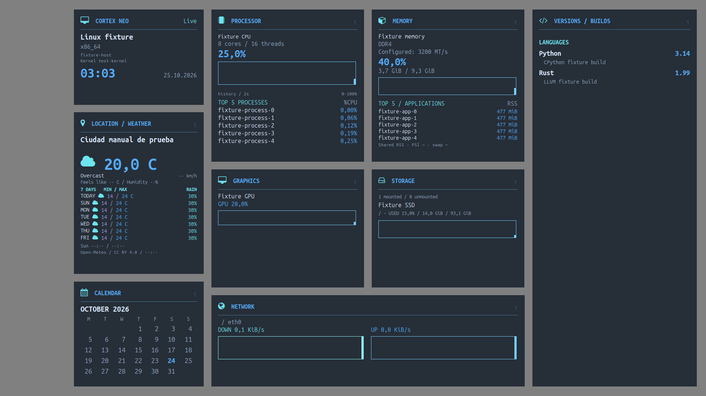

# CORTEX NEO · Conky Theme

**A living view of your Linux desktop.**

[Español](README.es.md) · [Documentation](docs/README.md) · [Changelog](CHANGELOG.md) · [License](LICENSE)

CORTEX NEO is a configurable desktop dashboard built with Conky, Python and Lua. Independent neon cards show CPU, memory, GPU, disks, network, Docker, installed versions/builds, a calendar and optional manually configured weather. **Version 0.1.0** starts the new international repository while retaining the predecessor's diagnostic tools.

## Install in one command

Download and extract the [source ZIP](https://github.com/JorgeTato99/cortex-neo-conky-theme/archive/refs/heads/main.zip). Open its directory and run as your desktop user:

```bash
bash scripts/install.sh
```

The installer prepares Conky, fonts and dependencies, creates an immutable Python runtime, and enables user services. Only apt needs sudo. Ubuntu 24.04/26.04 and Debian 12/13 have automatic package profiles. Python 3.11+, a graphical Linux session and user systemd are required. [Installation details](docs/getting-started/installation.md).

## Make it yours

```bash
cortex-neo configure --language en --palette blue --font ubuntu
cortex-neo configure --detail-level essential
cortex-neo configure --profile compact --density comfortable
cortex-neo configure --profile full --density complete --detail-level full
```

If the command is not yet on PATH, use `~/.local/bin/cortex-neo`.

- **Ten full palettes:** blue, teal, green, yellow, orange, red, pink, purple, slate and brown, matching Ubuntu 26's accent categories with colors adapted to this dark design.
- **Three font profiles:** Ubuntu Sans Mono, DejaVu Sans Mono and Liberation Mono, with availability checks/fallback.
- **Two languages:** English and Spanish, one implementation and parallel documentation.
- **Independent detail level:** hide secondary specifications/builds while keeping primary information, graphs and process tops.
- **Adaptive composition:** independent cards, matching margins, landscape/portrait, full/compact profiles and persistent opacity/card choices.

Edit simple JSON files under `~/.config/cortex-neo/`, or use the CLI. Updates preserve personal settings and manual city. Missing tools/sensors are omitted or marked unavailable rather than invented as zeros. [Configuration guide](docs/getting-started/configuration.md).

## Understand your machine

| Command | Purpose |
|---|---|
| `doctor`, `version` | Diagnose dependencies/session and identify installed source |
| `performance` | Observe dashboard CPU/RSS and payload cost |
| `memory` | Inspect available memory, swap and PSI; explicit PSS/USS |
| `containers` | Separate Engine/Desktop and Compose projects |
| `incident`, `history` | Keep bounded diagnostic windows and numeric minute history |
| `run`, `tasks` | Measure explicit build/test commands while preserving output/exit status |
| `context`, `baseline-save`, `compare` | Review selected capabilities and compare named observations |
| `presentation`, `report` | Hide personal dashboard labels and preview selected support output |

Reports are local and reviewed before sharing. Collection does not read command arguments or environments. Weather requires a manually configured city; there is no IP, GPS or Wi-Fi location detection. See [privacy](docs/reference/privacy.md) and [tool guides](docs/README.md).

## Previews and evidence

[Historical real desktops](docs/validation/screenshots.md) document both physical resolution and GNOME scaling. New palette/font previews are separately labeled actual Conky renders with synthetic data. All repository screenshots use lossless compression and preserve their original dimensions.

The project is checked through Python 3.11–3.15, real Lua callbacks, native ARM64 logic tests, four clean distribution installation/render jobs and two physical Ubuntu GNOME machines. These layers do not certify every GPU/desktop combination. [Compatibility](docs/reference/compatibility.md) · [Testing](docs/validation/testing.md).

## Update, contribute and reuse

Run the same installer from a newly extracted ZIP or your updated checkout, then check `cortex-neo version` and `cortex-neo doctor`. Failed activation restores the previous release. `cortex-neo uninstall` preserves personal data. [Lifecycle guide](docs/getting-started/updates-and-uninstall.md).

[Contributions](CONTRIBUTING.md), [compatibility reports](docs/validation/community.md) and new translations are welcome. English source docs and Spanish counterparts live in one branch; see [localization](docs/reference/localization.md).

Created by [Jorge Hernández Montero · JorgeTato99](https://github.com/JorgeTato99). MIT licensed: retain the copyright notice and license when reusing this work. External fonts, icons, weather data and software retain their own rights; see [third-party notices](THIRD_PARTY_NOTICES.md).



Actual Conky/Xvfb render with synthetic data · 1920 × 1080 · 100% scaling · 96 DPI · lossless WebP.

[All ten previews and configuration](docs/reference/appearance.md).
