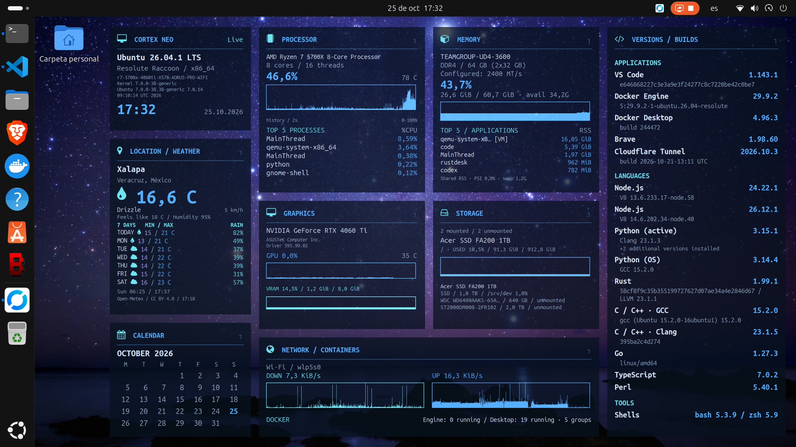
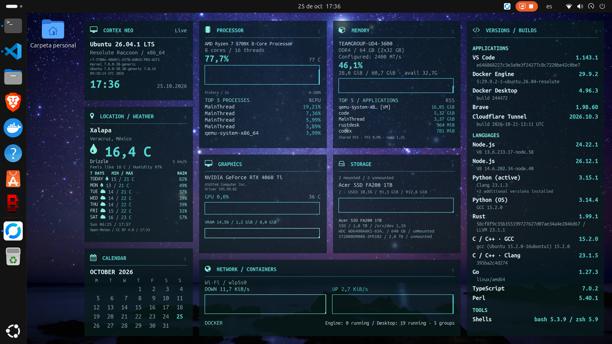
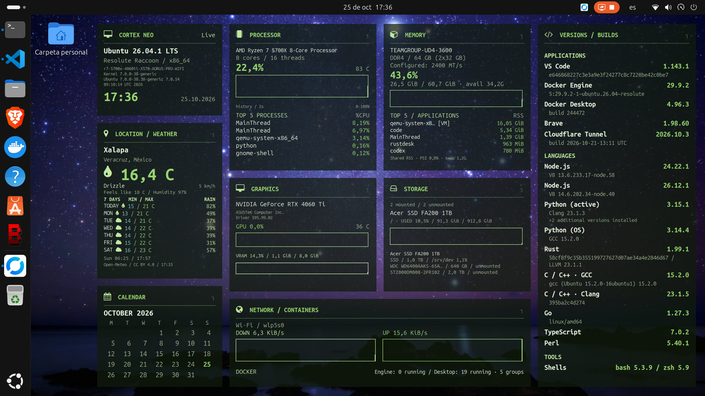
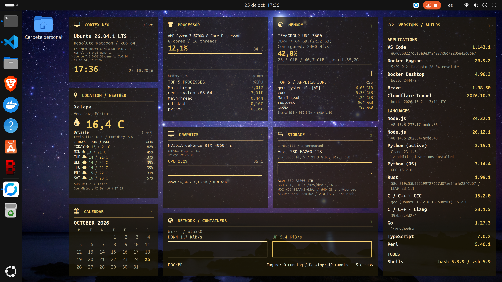
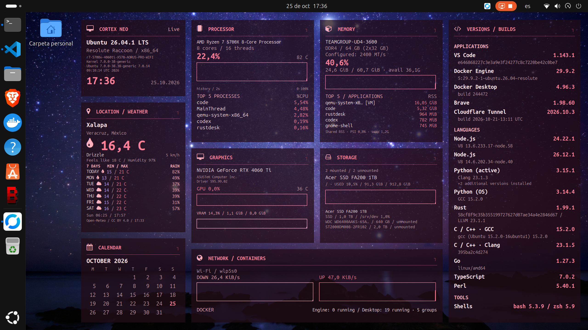
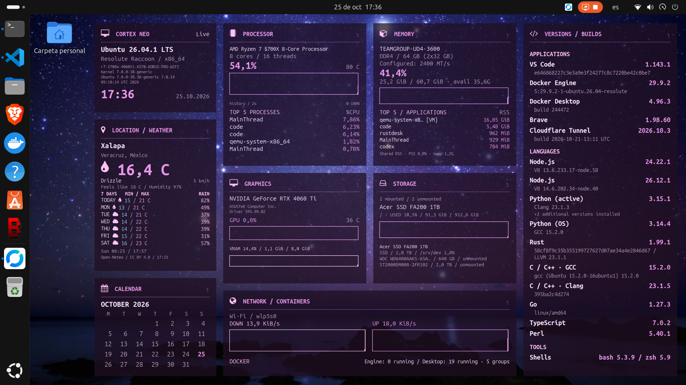
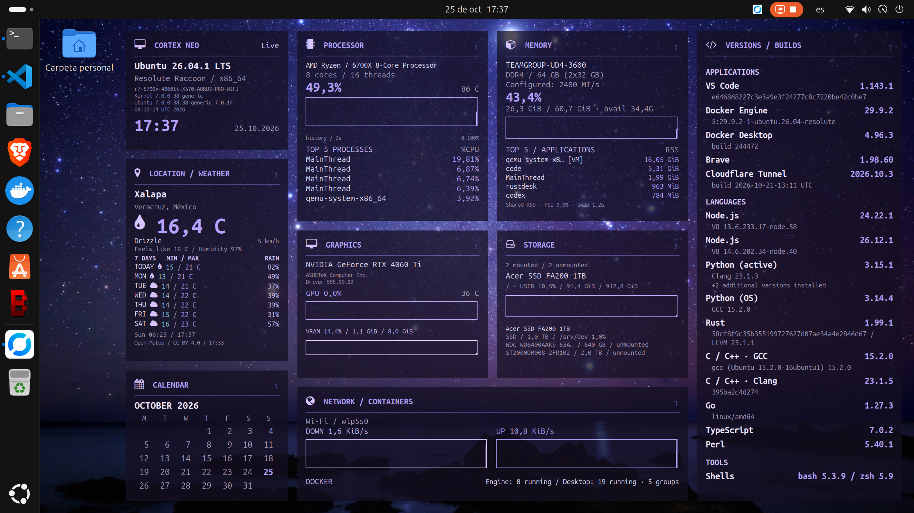
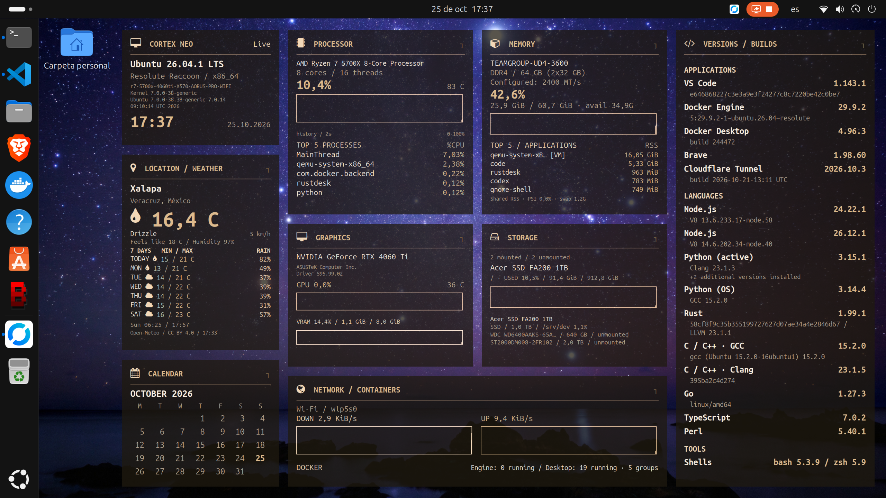

# Paletas, fuentes y detalle

Las diez variantes se muestran con **capturas reales del mismo Ryzen**, obtenidas mediante el portal normal de GNOME. Solo se cambió la paleta: fuente `ubuntu`, idioma `en` y detalle `full` permanecieron iguales. Al terminar se restauraron los archivos originales de preferencias.

**2560 × 1440 · escalado GNOME 166,67 % · escala interna del tema 1.0.** Capturas del 25 de octubre de 2026, versión 0.1.0. Los valores y el reloj reflejan cada momento; las gráficas reinician su ventana corta al regenerar las tarjetas. No se usaron datos sintéticos ni recoloración de imágenes.

| Paleta | Color principal | Imagen original |
|---|---|---|
| `blue` | `#55AEFF` | [Abrir](../../../assets/screenshots/ryzen-5700x-rtx4060ti.webp) |
| `teal` | `#56D6CE` | [Abrir](../../../assets/palettes/teal.webp) |
| `green` | `#96D56C` | [Abrir](../../../assets/palettes/green.webp) |
| `yellow` | `#F3CC61` | [Abrir](../../../assets/palettes/yellow.webp) |
| `orange` | `#FFAB75` | [Abrir](../../../assets/palettes/orange.webp) |
| `red` | `#FF8097` | [Abrir](../../../assets/palettes/red.webp) |
| `pink` | `#E896E8` | [Abrir](../../../assets/palettes/pink.webp) |
| `purple` | `#B3A1FF` | [Abrir](../../../assets/palettes/purple.webp) |
| `slate` | `#A7C8B2` | [Abrir](../../../assets/palettes/slate.webp) |
| `brown` | `#DDBA8D` | [Abrir](../../../assets/palettes/brown.webp) |

## Azul · `blue`



## Verde azulado · `teal`



## Verde · `green`



## Amarillo · `yellow`



## Naranja · `orange`


## Rojo · `red`



## Rosa · `pink`



## Morado · `purple`



## Pizarra · `slate`


## Marrón · `brown`



## Configuración

```bash
cortex-neo configure --palette purple --font ubuntu --detail-level full
cortex-neo configure --palette blue
```

Cada paleta define nueve roles: text, primary, secondary, muted, border, accent, warning, graph y background. `theme.json` admite colores hexadecimales de seis dígitos y opacidad de 0 a 1. Los alias neon/contrast/amber permanecen para migración.

Los perfiles de fuente son Ubuntu Sans Mono, DejaVu Sans Mono y Liberation Mono; fontconfig comprueba disponibilidad y sustituye familias ausentes. FontAwesome conserva los iconos.

El detalle `essential` oculta especificaciones y builds secundarios, manteniendo modelos, versiones, métricas, gráficas, tops y avisos de contabilidad/atribución. El perfil y la densidad siguen siendo opciones independientes.

[Procedencia y compresión](../validation/screenshots.md) · [Configuración](../getting-started/configuration.md)
