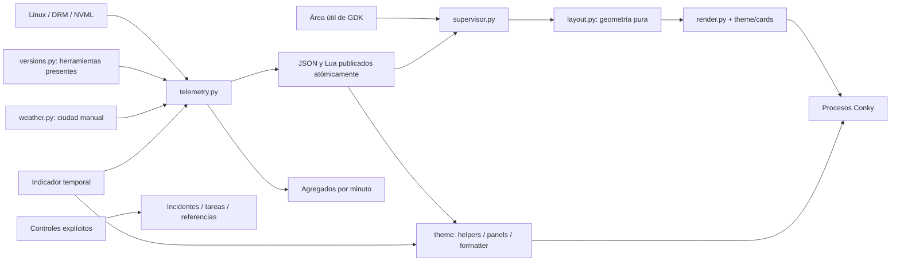

# Arquitectura y convenciones

CÓRTEX NEO separa descubrimiento, datos, disposición y presentación. Los dos
servicios son de usuario; su ciclo de vida pertenece a la sesión gráfica.

## Responsabilidades

- `paths.py`: ubicaciones XDG; una variable XDG relativa se descarta.
- `io.py`: comandos acotados, lecturas tolerantes, escape y publicación atómica.
- `system.py`: inventario CPU/RAM/PCI/discos y endpoints Docker.
- `gpu.py`: NVML opcional y sensores DRM. Conserva la unidad de cada magnitud.
- `processes.py`: un recorrido de procesos para CPU y RSS agrupado.
- `versions.py`: consultas sin instaladores; cada proveedor falla aisladamente.
- `weather.py`: configuración manual, caché, reintentos y caducidad.
- `telemetry.py`: un productor por usuario, muestreo compartido e historial limitado.
- `layout.py`: cálculo puro por área útil, capacidades y semanas del calendario.
- `display.py`: geometría de la sesión y recuperación del entorno gráfico.
- `render.py`: plantillas, escala, generaciones completas y parámetros de Conky.
- `supervisor.py`: procesos propios, alineación, ajuste Xft y cambios de pantalla.
- `capture.py`: portal estándar de capturas, incluida cancelación al vencer la espera.
- `__main__.py`: controles, diagnóstico e inventario; no mezcla recolección y UI.
- `diagnostics.py`: importaciones y conexiones reales con acciones de reparación.
- `conky.py`: capacidades del binario y sintaxis de backend/color según versión.
- `observability.py`: tiempos por proveedor y medición de procesos propios con unidades explícitas.
- `preferences.py`: configuración validada; temas personales fuera del código.
- `context.py`: fichas seleccionadas, cobertura y edad independiente del inventario.
- `memory.py`: presión/contadores globales y PSS/USS únicamente bajo demanda.
- `docker.py`: peticiones GET acotadas y un trabajador para inventario por contexto/Compose.
- `samples.py`: muestras numéricas y tops limitados para herramientas locales.
- `history.py`: agregados numéricos por minuto, retención y publicación tolerante a fallos.
- `records.py`: propiedad, bloqueo, publicación atómica y límites de registros privados.
- `incidents.py`: ventanas antes/después y exportación seleccionada.
- `tasks.py`: ejecución explícita, recursos observados y cancelación de identidades propias.
- `baselines.py`: referencias sin sobrescritura y comparación de observaciones.
- `sharing.py`: indicador de presentación como datos, leído también desde Lua, e informes filtrados.
- `version.py`: versión/revisión observadas y huella local de fuentes mantenidas.
- `scripts/manage_installation.py`: paquetes del SO, versiones inmutables y
  activación recuperable detrás del único punto de entrada `install.sh`.

## Instalación y actualización

La ruta XDG de datos contiene un enlace `cortex-neo` a una versión dentro de
`cortex-neo-releases/`. Cada una conserva su propio entorno virtual en la ruta
en que se creó; no se trasladan entornos con shebangs absolutos. Las preferencias
y cachés continúan separadas del código.

Se prepara y comprueba la nueva versión antes de detener los servicios. El cambio
del enlace es atómico. Los controles se respaldan y, si falla la activación,
se recuperan junto con la versión anterior. Solo apt eleva privilegios. La
desinstalación comprueba marcadores de propiedad y conserva los datos personales.

En Lua, `helpers.lua` concentra caché, escala, escape y ajuste de cadenas;
`panels.lua` construye bloques y páginas opcionales; `formatter.lua` ofrece los
callbacks de métricas, clima y calendario que consumen las plantillas.

## Invariantes

1. Un binario ausente o fallido no produce una versión ficticia ni un mensaje
   de shell dentro del escritorio. Una consulta parcial no elimina sus filas válidas.
2. Las categorías existen solo cuando tienen entradas. El inventario completo
   se conserva aunque la vista resuma Python o pagine entradas.
3. Ausencia de sensor no significa cero. Por ejemplo, Intel puede informar MHz
   sin ofrecer porcentaje de utilización. La frecuencia no se convierte en uso.
4. CPU/RAM y GPU/discos comparten dimensiones por fila. Se escalan geometría,
   fuentes, iconos y gráficas juntos; no se cambia únicamente el tamaño de la ventana.
5. Los datos externos pasan por escape antes de `lua_parse`. Los nombres largos
   se ajustan/abrevian para mantener el contenido dentro de su tarjeta.
6. El código, la configuración editable, los datos temporales y los respaldos
   viven en ubicaciones distintas. Los `.conf` generados no son fuentes editables.
7. La ciudad es **manual**. Ningún fallback consulta GeoIP, GPS, GeoClue o redes
   cercanas. Sin configuración manual válida no hay consulta meteorológica.
8. Las fichas e informes seleccionan campos; no copian un snapshot para intentar
   borrar secretos después. Un inventario parcial no acredita eliminación.
9. Presentación no ejecuta su indicador ni depende de que el recolector avance.
   Un indicador inválido conserva el ocultamiento. No se cambia configuración persistente.
10. Los comandos de tarea son opt-in, sin shell implícita ni registro de argumentos;
    su cancelación se limita al grupo creado y a identidades verificadas.

## Coste y recuperación

| Trabajo | Cadencia |
|---|---|
| CPU, RAM, procesos, GPU, tráfico y uso de disco | 2 s |
| Ruta de red y Docker | 15 s |
| Inventario de discos | 30 s o al cambiar un montaje de dispositivo |
| Firma de montajes / uso de filesystems | 2 s; lectura local pequeña |
| Configuración de ciudad | 30 s |
| Metadatos del sistema | 60 s |
| Versiones de aplicaciones y lenguajes | Al iniciar y cada hora |
| Clima | 15 min; reintento de 5 min tras fallo |
| Geometría/capacidades de la pantalla | 10 s |
| Agregados numéricos históricos | Muestreo 2 s; publicación al minuto y parada normal |
| Indicador de presentación | Lectura local 2 s; también desde cada instancia Lua |
| PSS/USS, tareas, incidentes, referencias e informes | Solo por petición explícita |

Las consultas meteorológicas y de versiones no bloquean el muestreo de
hardware. Los comandos tienen timeout y el modo de consulta desactiva la
instalación automática de toolchains de Rustup/Go. La escritura usa un archivo
temporal distinto y un reemplazo atómico. `flock` evita dos productores sobre
la misma caché. El historial tiene como máximo 121 muestras.

`DiskMonitor` compara únicamente fuente, destino y raíz de montajes de dispositivos
en `/proc/self/mountinfo`. No vuelve a enumerar todo el hardware cada dos segundos
ni reacciona a cada overlay de Docker. Un montaje/desmontaje actualiza el inventario
antes de tomar el uso; el refresco periódico cubre dispositivos nuevos sin montar.

Una muestra viva de más de diez segundos se señala como antigua; no se presenta
como 0 %. Los errores opcionales esperados no imprimen trazas en las tarjetas.
Los fallos inesperados se registran en el journal para diagnóstico.

El supervisor prepara cada generación completa, detiene sus procesos y abre
los nuevos. Comprueba la altura real de Xft para corregir redondeos. Conserva
tres generaciones; no termina otras aplicaciones Conky ajenas al servicio.

`dashboard.json` conserva la ventana corta con tops; el payload Lua omite ese
historial que las gráficas nativas no consumen. El inventario Docker se actualiza
en un trabajador separado. La versión del software conserva su propio timestamp,
porque una muestra de CPU actual no vuelve reciente una consulta de hace una hora.

El estado XDG contiene agregados sin nombres y registros privados explícitos.
Incidentes/tareas tienen retención automática de diez registros; las referencias
admiten veinte y requieren eliminación explícita. Ningún exportador los publica.
La huella de versión mide fuentes, no venv, datos personales ni paquetes del SO.
Los metadatos de revisión se incorporan al preparar la versión inmutable.

## Estilo de mantenimiento

Python: cuatro espacios, `snake_case`, constantes `UPPER_CASE`, imports ordenados
y Ruff. Lua: cuatro espacios, StyLua y helpers compartidos. Textos UTF-8 con LF.
Comentarios/docstrings en inglés y documentación de usuario en español.
Se documenta el porqué de decisiones no obvias, no operaciones triviales ni
historiales de iteraciones dentro del código.

Cambios visuales: editar `theme/cards/`, `theme/*.lua` o `render.py`. Cambios de
geometría: `layout.py`. Reiniciar con `cortex-neo restart` tras editar fuentes.
Los cambios de monitor/configuración de escala se detectan automáticamente.

## Referencias técnicas

- [Opciones de Conky](https://conky.cc/config_settings) y manual instalado:
  configuración X11, márgenes, Lua y condiciones de dibujo.
- [GDK get_workarea](https://docs.gtk.org/gdk3/method.Monitor.get_workarea.html):
  distingue píxeles de aplicación y de dispositivo y excluye paneles/dock.
- [Especificación XDG](https://specifications.freedesktop.org/basedir/latest/):
  separación de configuración, datos, caché y estado.
- [Ruff](https://docs.astral.sh/ruff/formatter/) y
  [StyLua](https://github.com/JohnnyMorganz/StyLua): formato reproducible.
- [Rustup](https://rust-lang.github.io/rustup/environment-variables.html) y
  [Go toolchains](https://go.dev/doc/toolchain): consultas sin descargas automáticas.
- [Portal Request](https://flatpak.github.io/xdg-desktop-portal/docs/doc-org.freedesktop.portal.Request.html):
  respuesta de usuario y cierre de una solicitud vencida.
